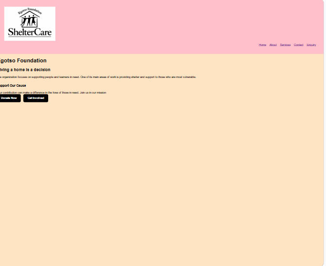
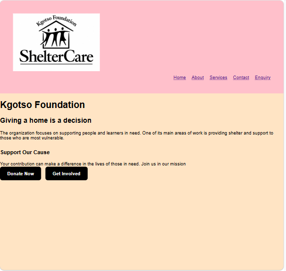
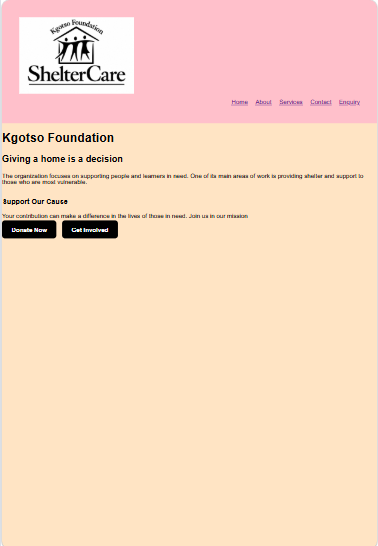

# ST10522853_Mathole_WEDE5020_POE1

# Kgotso Foundation Website - WEDE5020
Name & Surname: Keabetswe Mathole
Student Number: ST10522853
Module: Web Development (WEDE5020)

### About The Project
Kgotso Foundation is a Shelter care organization that provides shelter for homeless people and also assist learners who are struggling with their school work.

This website will make the organization to be known by many community members, as it was only a few who knew about it.

### Website Pages
-index.html - Home page with colorful background, intro, CTA to Enquiry
-about.html - Organization story, mission, and vision
-services.html - Services provided ny our organization
-enquiry.html - Enquiry forms for people who want to join our organization and forms for donators
-contact.html - Address, email address, phone

### Design Choices
- Colours: Black #000000, Bisque #FFE4C4, Pink #FFC0CB
- Fonts: Poppins for heading, Open Sans for body text
- Layout: Mobile-first responsive (375px, 768px, 1923px)

### Technologies Used
-HTML5
-CSS3

### File Structure

│
├── css/
│   └── styles.css         
│
├── Images/
│   ├── Kgotso_logo.jpg    
│   ├── Desktop.png         
│   ├── Tablet.png         
│   └── Mobile.png          
│
├── index.html              
├── about.html              
├── Services.html          
├── Contact.html            
├── Enquiry.html            
└── README.md            

### How to Run
No need to install just double click the page in the file explorer and the page will appear on the browser.

### Hosting Plan
Part 1: Github Pages (free)
Future : Custom .co.za domain

### Responsive Design Evidence
#### Desktop (1923px)

#### Tablet (768px)

#### Mobile (375px)

